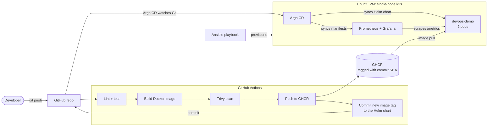
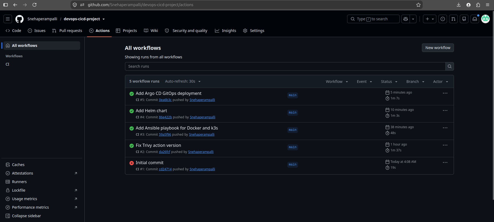
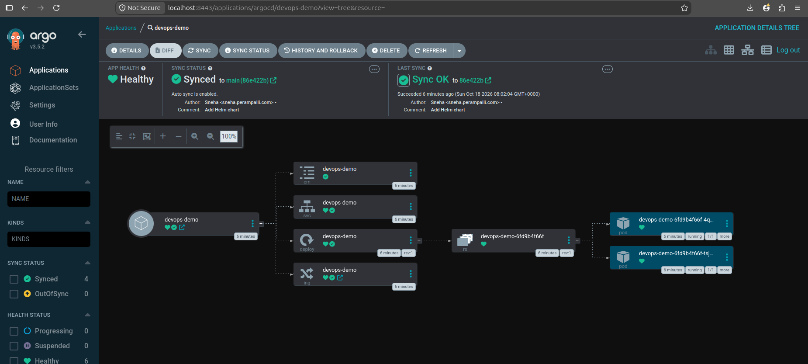
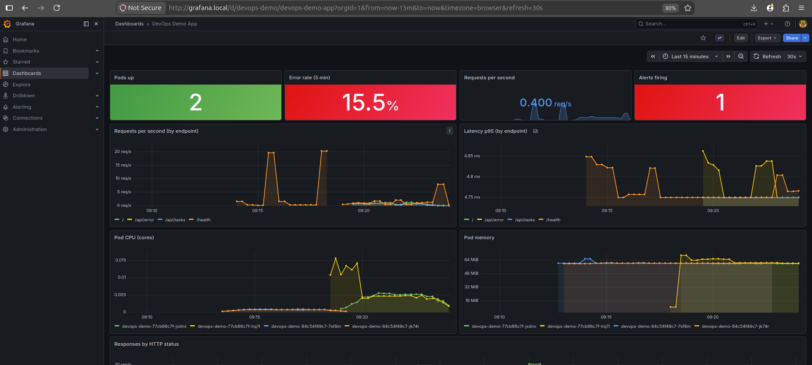
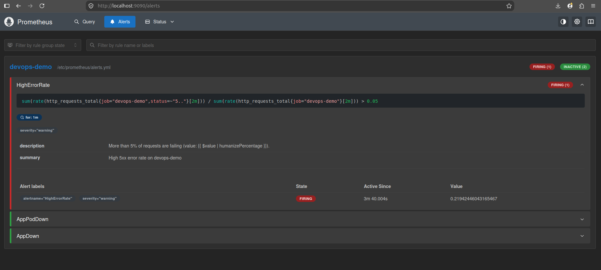

# DevOps CI/CD + GitOps Project


An end-to-end delivery pipeline for a small Python API: every `git push` is
linted, tested, containerized, security-scanned and published automatically, then
deployed to a Kubernetes cluster by Argo CD (GitOps), with live Grafana dashboards
and Prometheus alerts. Everything uses free tools and runs on a single Ubuntu VM
with 2 CPUs and 4 GB of RAM.

## Architecture



## Tech stack

| Area | Tool |
|---|---|
| OS and provisioning | Ubuntu, Ansible |
| App | Python 3.12, Flask, gunicorn, pytest, flake8 |
| Containers | Docker (multi-stage, non-root), GitHub Container Registry |
| CI | GitHub Actions |
| Security scanning | Trivy |
| Kubernetes | k3s (single node), Traefik ingress |
| Packaging | Helm (app), Kustomize (monitoring) |
| CD / GitOps | Argo CD |
| Monitoring and alerting | Prometheus, Grafana |

## Screenshots

**CI pipeline: all checks green**



**Argo CD: app Synced and Healthy**



**Grafana dashboard: requests, latency, errors, pod CPU and memory**



**Prometheus alert firing under a simulated error spike**



## How a change reaches the cluster

1. A push to `main` starts the **CI** workflow: flake8 and pytest.
2. The image is built and scanned with Trivy. The build fails on any fixable
   HIGH or CRITICAL vulnerability.
3. The image is pushed to GHCR, tagged with the commit SHA.
4. A final CI job commits that SHA into `helm/devops-demo/values.yaml`.
5. **Argo CD** sees the new commit and syncs the cluster (it polls Git every
   3 minutes by default). No one runs `kubectl` or `helm`.
6. Kubernetes starts a new pod, waits for its readiness probe, then removes an old
   one, so there is no downtime.

## Highlights

- **Reproducible host:** one Ansible playbook installs Docker, swap and k3s and is safe to re-run.
- **Secure containers:** the app runs as a non-root user with a read-only root filesystem, all Linux capabilities dropped and no privilege escalation, and its image is scanned before it is published.
- **Safe rollouts:** 2 replicas, `maxUnavailable: 0`, liveness and readiness probes on `/health`, CPU and memory requests and limits.
- **GitOps:** Git is the source of truth. Argo CD auto-syncs, prunes removed resources and self-heals manual changes.
- **No secrets in Git:** the chart can load credentials from an existing Kubernetes Secret instead.
- **Observability:** the app exports request count and latency metrics. A provisioned Grafana dashboard shows rate, errors, p95 latency, pod CPU and memory. Alert rules cover high error rate, a pod down, and the app fully down.
- **Pinned versions:** Argo CD v3.5.2, Prometheus v3.13.4 (LTS), Grafana 12.4.3, Trivy action 0.35.0 (a release the maintainers confirmed was unaffected by the March 2026 supply-chain incident).

## Repository layout

```
app/            Flask app, tests, Dockerfile
ansible/        Playbook: Docker, swap, k3s
helm/           Helm chart for the app
argocd/         Argo CD Application definitions
monitoring/     Prometheus + Grafana (Kustomize), alert rules, dashboard
.github/        CI workflow
docs/images/    Screenshots used in this README
```

The `ansible/`, `helm/`, `argocd/` and `monitoring/` folders each have their own README with details.

## Quick start (fresh Ubuntu VM)

Requirements: Ubuntu with 2 CPUs, 4 GB RAM and about 25 GB of free disk, and the
GitHub package (container image) set to **public**.

```bash
# 1. Install git and Ansible, then get the code
sudo apt update && sudo apt install -y git ansible-core
git clone https://github.com/Snehaperampalli/devops-cicd-project.git
cd devops-cicd-project

# 2. Provision Docker, swap and k3s
(cd ansible && ansible-playbook site.yml --ask-become-pass)
export KUBECONFIG=$HOME/.kube/config

# 3. Install Argo CD (pinned) and switch off the parts a small VM does not need
kubectl create namespace argocd
kubectl apply -n argocd --server-side --force-conflicts \
  -f https://raw.githubusercontent.com/argoproj/argo-cd/v3.5.2/manifests/install.yaml
kubectl -n argocd scale deployment \
  argocd-dex-server argocd-notifications-controller argocd-applicationset-controller --replicas=0

# 4. Let Argo CD deploy the app and the monitoring stack from Git
kubectl apply -f argocd/application.yaml
kubectl apply -f argocd/monitoring-application.yaml
kubectl -n argocd get applications
```

If you fork this repo, change the GitHub username in three places:
`image.repository` in `helm/devops-demo/values.yaml`, and `repoURL` in
`argocd/application.yaml` and `argocd/monitoring-application.yaml`.

### Open the apps

```bash
echo "127.0.0.1 devops-demo.local grafana.local" | sudo tee -a /etc/hosts
curl http://devops-demo.local/health          # {"status":"ok"}
```

- Grafana: http://grafana.local (login `admin` / `admin`, you are asked to change it)
- Prometheus: `kubectl -n monitoring port-forward svc/prometheus 9090:9090`, then http://localhost:9090
- Argo CD: `kubectl -n argocd port-forward svc/argocd-server 8443:443`, then https://localhost:8443
  (user `admin`, password from `kubectl -n argocd get secret argocd-initial-admin-secret -o jsonpath="{.data.password}" | base64 -d`)

## Try it

**Deploy a change:** edit the message in `app/app.py` (the `/` endpoint), push, and
watch Actions, then Argo CD, then `curl http://devops-demo.local/`. The new message
and commit SHA appear without any manual deploy step.

**Trigger the alert:** send a mix of good and failing requests for a few minutes.

```bash
for i in $(seq 1 400); do
  curl -s -o /dev/null http://devops-demo.local/health
  curl -s -o /dev/null http://devops-demo.local/api/tasks
  curl -s -o /dev/null http://devops-demo.local/
  curl -s -o /dev/null http://devops-demo.local/api/error
  sleep 0.5
done
```

The error-rate panel turns red and `HighErrorRate` reaches Firing on the Prometheus
Alerts page.

## Design decisions and trade-offs

- **One repo for app and chart.** It keeps the project simple. Larger teams usually keep deployment config in a separate repo.
- **Sized for a 4 GB VM.** Argo CD's SSO, notification and ApplicationSet components are scaled to zero. Monitoring uses small, hand-written manifests instead of the full kube-prometheus-stack, with memory limits and Go memory limits set on both.
- **Alerts are visible, not delivered.** Alertmanager is left out to save memory, so alerts show in Prometheus and Grafana but do not send notifications. Adding Alertmanager with a Slack or email receiver is the natural next step.
- **Monitoring data is not persistent.** Prometheus and Grafana use `emptyDir`, so history is lost when a pod restarts. A production setup would use persistent volumes.
- **Single node.** k3s on one VM is enough to demonstrate the workflow. It is not highly available.

## Troubleshooting

- **`ImagePullBackOff`:** the GHCR package is still private. Make it public in the package settings.
- **Ansible stalls at "Timed out waiting for become success or become password prompt":** newer Ubuntu releases use `sudo-rs`, which Ansible cannot type a password into. Temporarily allow passwordless sudo for your user (`echo "$USER ALL=(ALL) NOPASSWD:ALL" | sudo tee /etc/sudoers.d/ansible-temp`), run the playbook without `--ask-become-pass`, then remove that file.
- **`kubectl` says it cannot read `/etc/rancher/k3s/k3s.yaml`:** run `export KUBECONFIG=$HOME/.kube/config`.
- **Slow VM or full swap:** close the browser while the cluster runs, or scale Grafana down with `kubectl -n monitoring scale deployment grafana --replicas=0`.
- **Branch protection:** if you require pull requests on `main`, allow `github-actions` to bypass it, or the CI job that commits the image tag cannot push.

## Run the app locally

```bash
cd app
python3 -m venv .venv && source .venv/bin/activate
pip install -r requirements-dev.txt
flake8 . && pytest -v
python app.py          # http://localhost:8080
```

| Endpoint | Method | Purpose |
|---|---|---|
| `/` | GET | Name and version |
| `/health` | GET | Liveness and readiness probe |
| `/api/tasks` | GET, POST | Simple in-memory task list |
| `/api/error` | GET | Returns 500 on purpose, for testing alerts |
| `/metrics` | GET | Prometheus metrics |

## Possible next steps

- Alertmanager with a Slack or email receiver
- Horizontal Pod Autoscaler with a load test
- Persistent volumes for Prometheus and Grafana
- Terraform for a cloud-hosted cluster
- Pin GitHub Actions to full commit SHAs
